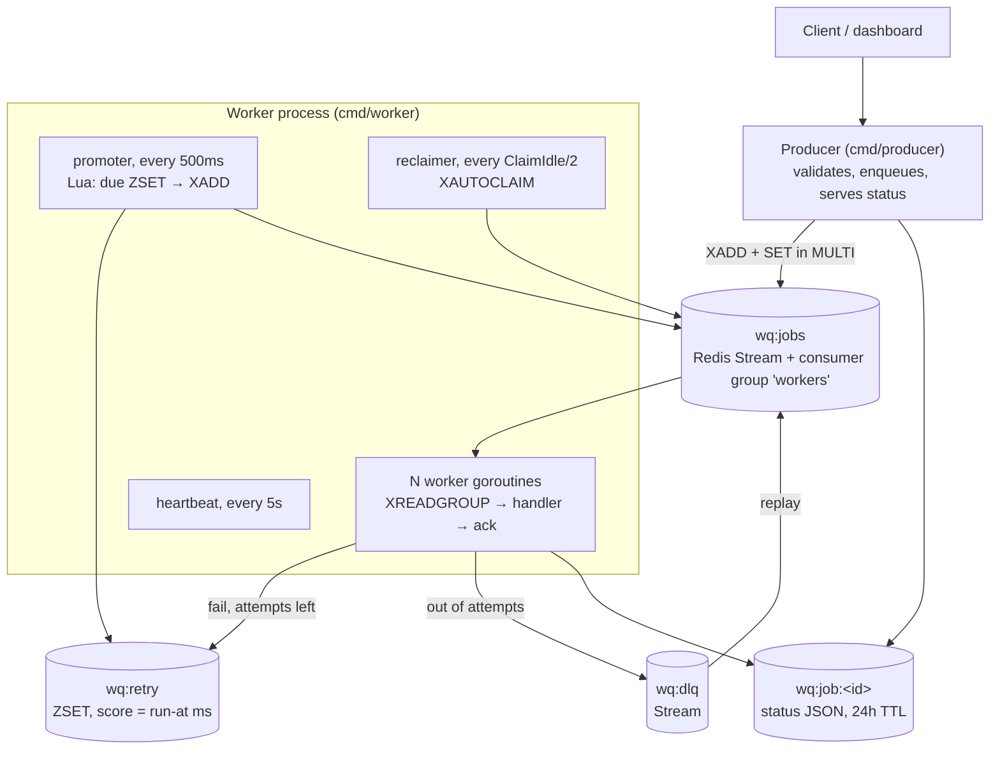
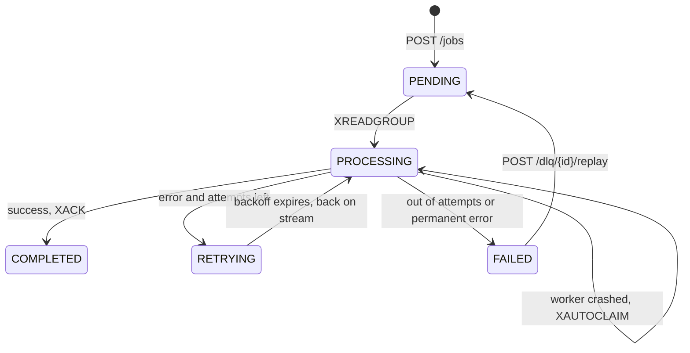

# WorkQueue Architecture

## Components

## Redis keys

| Key | Type | Purpose |
|---|---|---|
| `wq:jobs` | Stream | Jobs waiting or in flight. Consumer group `workers`. Entries are `XDEL`ed once acked so the stream stays small. |
| `wq:retry` | Sorted set | Failed jobs waiting for backoff. Score is the run-at time in Unix ms; member is the job JSON. |
| `wq:dlq` | Stream | Jobs that ran out of attempts, with their last error. |
| `wq:job:<id>` | String | Latest job JSON for `GET /jobs/{id}`. Expires after 24 h. |
| `wq:stats` | Hash | `completed`, `retried`, `failed` counters shared by all workers. |
| `wq:worker:<consumer>` | String | Heartbeat: goroutine count, 15 s TTL. |

## Job lifecycle

## One attempt, step by step (`worker.Pool.Handle`)

1. `XREADGROUP ... >` delivers a message to this consumer. Redis records it in the group's **pending entries list (PEL)** with a delivery time.
2. The worker marks the job `PROCESSING`, increments `attempts`, and saves the status record.
3. The handler runs with a context deadline of `JOB_TIMEOUT`. Panics are recovered and become errors.
4. The outcome is written in **one `MULTI`/`EXEC` transaction**:
   - success: `XACK` + `XDEL` + status `COMPLETED` + `HINCRBY completed`
   - retryable error: `ZADD wq:retry` + `XACK` + `XDEL` + status `RETRYING` + `HINCRBY retried`
   - final error: `XADD wq:dlq` + `XACK` + `XDEL` + status `FAILED` + `HINCRBY failed`
5. If that transaction fails (say Redis blips), nothing is acked. The message stays in the PEL and gets reclaimed later. A failure at any step therefore leads to a re-run, never to a lost job.

## Retries and backoff

`delay = min(base × 2^(attempt-1), max)`, then **equal jitter**: half of that delay is fixed and the other half is random. With the defaults (`1s`, `1m`), retries land roughly at 0.5–1 s, 1–2 s and 2–4 s. Without jitter, a thousand jobs that failed together (for example during an SMTP outage) would all retry at the same instant and could cause the outage again.

Streams have no delayed delivery, so retries wait in a sorted set. Every 500 ms each worker process runs a Lua script that, inside Redis, does `ZRANGEBYSCORE` for due jobs, `ZREM`s them and `XADD`s them back to the stream. Because the script runs atomically, two workers can never promote the same job, and a crash can't leave a job removed from the ZSET but not yet added to the stream.

Errors wrapped with `handlers.Permanent` (for example invalid image dimensions) skip retries, since retrying can't fix bad input.

## Crash recovery

If a worker process dies after `XREADGROUP` but before `XACK`, its messages stay in the PEL. Every worker process runs a reclaimer that calls `XAUTOCLAIM` with `min-idle-time = ClaimIdle` (default `2 × JOB_TIMEOUT`), takes ownership of messages that have been idle that long, and processes them.

ClaimIdle must be longer than JobTimeout. Otherwise a job that is slow but still running could be "reclaimed" and run twice at the same time. `Config.defaults()` enforces this.

This was verified by hand: 20 jobs were submitted, a worker was `kill -9`ed with 5 jobs in flight, and a new worker was started. All 5 were reclaimed and all 20 completed. `TestJobFromCrashedWorkerIsRecovered` automates the same scenario.

## Graceful shutdown

On SIGINT/SIGTERM (`signal.NotifyContext`):

1. The pool context is cancelled. Worker loops stop calling `XREADGROUP`; the 1 s block timeout bounds how long that takes.
2. Jobs that are already running continue. `Handle` deliberately uses its own context (bounded by `JOB_TIMEOUT`), not the pool context, so shutdown doesn't abandon a half-finished job or fail to ack it.
3. `WaitGroup.Wait()` returns once every goroutine is done; the heartbeat is deleted; the HTTP server and Redis client close.

## Trade-offs

- **At-least-once, not exactly-once.** The gap between "handler finished" and "XACK" can't be closed without the handler's side effect and the ack sharing one transaction. The standard answer is idempotent handlers or idempotency keys.
- **Poison messages that kill the process.** A panic is caught, but a job that makes the process OOM or segfault would be reclaimed forever. The fix is to read the delivery count from `XPENDING` and dead-letter the job after N deliveries.
- **Polling the retry ZSET** adds up to 500 ms of extra delay and one small Lua call per tick per worker process. That's fine at this scale; a busier system might use a single leader to do the promotion.
