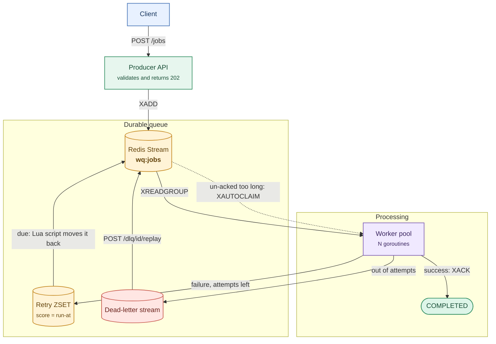

# WorkQueue


A background job queue in Go, built on Redis Streams.

The system uses Redis Streams and consumer groups to provide acknowledgement-based processing. Jobs remain recoverable until acknowledged, failures are retried with backoff, and jobs that exceed their attempt limit are routed to a replayable dead-letter queue.


## Quick start

```bash
docker compose up --build
```

The producer dashboard is available at [http://localhost:8080](http://localhost:8080). It exposes queue statistics, job submission, retry activity, and dead-letter replay.

The Compose stack also supports crash-recovery validation:

```bash
docker compose kill -s SIGKILL worker
docker compose start worker
```

Jobs left pending by the terminated worker are reclaimed after `JOB_TIMEOUT`. Multiple worker processes can be started with `docker compose up --build --scale worker=3`.

For local Go execution, Redis 6.2 or newer is required:

```bash
cp .env.example .env
go run ./cmd/worker     # terminal 1
go run ./cmd/producer   # terminal 2
```

The producer executable can also initialize the worker pool in the same process, which supports single-service deployments. Docker Compose intentionally keeps the producer and worker executables separate so local scaling and crash-recovery behavior remain easy to exercise.

## How it works



The producer validates requests, writes jobs to the stream, and returns `202` with a job ID. Workers read through a consumer group and acknowledge (`XACK`) a job only after its handler succeeds.

Failure handling:

| Situation | Result |
|---|---|
| Handler returns an error | Retried after `base × 2^(attempt-1)` plus jitter, up to `MAX_ATTEMPTS` |
| Error wrapped in `handlers.Permanent` | No retries, straight to the dead-letter queue |
| Out of attempts | Dead-letter queue, with the last error kept |
| Handler panics | Recovered and counted as a failed attempt |
| Worker killed mid-job | Another worker reclaims it with `XAUTOCLAIM` after `2 × JOB_TIMEOUT` |
| SIGTERM | Stops reading, finishes running jobs, then exits |
| Redis down | Workers back off instead of spinning, the API returns `503` |

Delivery is at-least-once. A worker that finishes a job but exits before acknowledging it can cause the job to run again; handlers must therefore tolerate duplicate execution. Redis keys and failure-path details are documented in [ARCHITECTURE.md](ARCHITECTURE.md).

## Benchmarks

The benchmark starts a real worker pool, enqueues jobs from eight concurrent producers, and measures enqueue-to-acknowledgement latency. CI runs it on every push. The following run used 2,000 jobs with 10 ms of simulated work on a GitHub Actions runner:

| Workers | Throughput | p50 latency | p99 latency |
|--------:|-----------:|------------:|------------:|
| 1  | 92 jobs/s    | 10.9 s | 21.5 s |
| 5  | 446 jobs/s   | 2.2 s  | 4.3 s  |
| 20 | 1,740 jobs/s | 531 ms | 1.0 s  |

Throughput scales approximately with worker count for this I/O-bound workload. Latency reflects burst backlog time rather than handler duration. A no-op handler reached approximately 12,000 jobs/s on a 2-core machine with Redis running locally.

## API

| Method | Path | |
|---|---|---|
| `POST` | `/jobs` | Validate and enqueue a job, returns `202` and a job ID |
| `GET` | `/jobs/{id}` | Status, attempts, last error, next retry time (kept 24 h) |
| `GET` | `/stats` | Queued, in-flight, retrying, dead-letter, completed, failed, live workers |
| `GET` | `/dlq` | Newest dead-lettered jobs |
| `POST` | `/dlq/{entry_id}/replay` | Put a dead letter back on the queue with attempts reset |
| `GET` | `/healthz` | Redis connection check |

```bash
curl -X POST localhost:8080/jobs \
  -d '{"task_type":"send_email","payload":{"to":"user@example.com","subject":"hello"}}'
# {"job_id":"9f2c...","status":"PENDING","status_url":"/jobs/9f2c...","task_type":"send_email"}
```

Task types are `send_email`, `resize_image`, `generate_pdf`, and `flaky_task`. Handlers simulate work because the project focuses on queue reliability rather than external task integrations. `WORKER_COUNT`, `MAX_ATTEMPTS`, `JOB_TIMEOUT`, and retry delays are configured through environment variables listed in [.env.example](.env.example).

## Design decisions

- Streams instead of a list: a consumer group keeps each message in a pending list until it's acked, which is what makes crash recovery possible.
- Retries wait in a sorted set scored by run-at time, because streams can't delay delivery. A small Lua script moves due jobs back, so two workers can never promote the same one.
- Each outcome (done, retry, dead-letter) acks the message and writes the next state in one `MULTI`/`EXEC`, so a job can't be acked and lost.
- Job status is a small JSON key with a 24 h expiry, and counters live in Redis, so they stay correct with several worker processes.

## Tests

```bash
go test -race ./...
```

The integration tests need Redis at `REDIS_URL` and skip if there isn't one (CI sets `REQUIRE_REDIS=1` so they fail there instead). They cover the failure paths: a job that's read but never acked gets reclaimed, retries end in the dead-letter queue, permanent errors skip retries, a panicking handler doesn't kill the worker, and shutdown waits for a running job. Each test uses its own random key prefix, so it never touches real queue data.

## Limitations

- A job can run twice, so a real system would add idempotency keys.
- A job that crashes the whole process (not just a panic) on every attempt would be reclaimed forever. Reading the delivery count from `XPENDING` would let it go to the dead-letter queue.
- One Redis instance, no auth or rate limiting on the API.

Meet Jain · [github.com/MeetJain05](https://github.com/MeetJain05)
