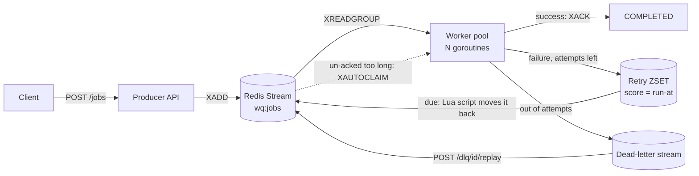

# WorkQueue


A background job queue in Go built on **Redis Streams**. An HTTP producer accepts jobs and returns immediately; a pool of workers processes them with **at-least-once delivery**, **exponential-backoff retries**, a **dead-letter queue**, and **crash recovery**.


## Why

Slow work (sending email, resizing images, generating PDFs) should not block an API request. The producer puts the job on a queue and answers `202 Accepted` with a job ID straight away. Workers do the work in the background, and the caller can check progress at `GET /jobs/{id}`.

The interesting part is what happens when things go wrong: a worker crashes mid-job, a downstream service times out, or a job can never succeed. Those cases drive most of the design below.

## Architecture



Full details, including the Redis key layout and failure scenarios, are in [ARCHITECTURE.md](ARCHITECTURE.md).

## Delivery guarantees

| Situation | What happens |
|---|---|
| Handler succeeds | Worker `XACK`s the message, saves status `COMPLETED`, all in one `MULTI` transaction. |
| Handler returns an error, attempts left | Job is scheduled in a sorted set with delay `base × 2^(attempt-1)` plus jitter, and acked from the stream in the same transaction. |
| Handler returns `handlers.Permanent(err)` (e.g. bad input) | Skips retries and goes straight to the dead-letter queue. |
| Out of attempts | Moved to the dead-letter stream with its last error. It can be inspected and replayed over the API. |
| Handler panics | Panic is recovered and treated as a failed attempt, so one bad job can't take down the worker. |
| **Worker crashes (`kill -9`) mid-job** | The message stays in the consumer group's pending list. Another worker reclaims it with `XAUTOCLAIM` once it has been idle for longer than `2 × JOB_TIMEOUT` and runs it again. |
| Worker receives SIGTERM | Stops taking new jobs, finishes the ones it is running, acks them, then exits. |
| Redis is down | Workers back off (100 ms doubling up to 5 s) instead of spinning; the producer returns `503`. |

Delivery is **at-least-once**, not exactly-once: if a worker finishes a job and crashes before acking, the job runs again. Handlers should therefore be idempotent.

## Benchmarks

`go run ./cmd/bench` starts a real worker pool against Redis, enqueues jobs from 8 concurrent producers, and computes end-to-end latency (enqueue → acked as `COMPLETED`) from every job's status record. CI runs it on every push and posts the table to the job summary.

**Queue overhead** (5,000 jobs, handler does no work), 2 vCPU VM with Redis on the same machine:

| Workers | Throughput | p50 latency | p99 latency |
|--------:|-----------:|------------:|------------:|
| 1  | 5,217 jobs/s  | 376.6 ms | 859.9 ms |
| 5  | 10,191 jobs/s | 185.2 ms | 344.1 ms |
| 20 | 12,060 jobs/s | 40.0 ms  | 68.3 ms  |
| 50 | 12,310 jobs/s | 1.0 ms   | 5.8 ms   |

**Scaling with I/O-bound work** (2,000 jobs, 10 ms simulated work each):

| Workers | Throughput | Ideal (workers ÷ 10 ms) |
|--------:|-----------:|------------------------:|
| 1  | 92 jobs/s    | 100   |
| 5  | 456 jobs/s   | 500   |
| 20 | 1,756 jobs/s | 2,000 |
| 50 | 4,187 jobs/s | 5,000 |

Throughput scales close to linearly with worker count while the work is I/O-bound, and the queue itself levels off at about 12k jobs/s on this machine, where Redis round trips and CPU become the limit. All jobs are enqueued in a burst before the pool can drain them, so latency here mostly measures time spent waiting in the backlog. Once there are enough workers to keep up (50), p50 latency drops to about 1 ms.

## API

| Method | Path | Description |
|---|---|---|
| `POST` | `/jobs` | Validate and enqueue a job. Returns `202` with `job_id` and a `Location` header. |
| `GET` | `/jobs/{id}` | Current status, attempts, last error and next retry time (kept for 24 h). |
| `GET` | `/stats` | Queued, in-flight, retrying, dead-letter, completed and failed counts, plus live workers. |
| `GET` | `/dlq?limit=20` | Newest dead-lettered jobs. |
| `POST` | `/dlq/{entry_id}/replay` | Move a dead letter back to the queue with its attempts reset. |
| `GET` | `/healthz` | Checks the Redis connection. |

```bash
curl -i -X POST localhost:8080/jobs \
  -d '{"task_type":"send_email","payload":{"to":"user@example.com","subject":"hello"}}'
# HTTP/1.1 202 Accepted
# Location: /jobs/9f2c...
# {"job_id":"9f2c...","status":"PENDING","status_url":"/jobs/9f2c...","task_type":"send_email"}

curl localhost:8080/jobs/9f2c...
# {"job_id":"9f2c...","status":"COMPLETED","attempts":1,"max_attempts":3,...}
```

Task types: `send_email`, `resize_image`, `generate_pdf`, and `flaky_task`, which fails at a configurable rate so you can watch retries and the dead-letter queue. The handlers simulate their work (with context-aware sleeps) so the project stays focused on the queue. Payloads are validated in the producer, so bad requests get a `400` instead of failing later in a worker.

## Run it

```bash
docker compose up --build                       # Redis + producer + 5 workers
docker compose up --build --scale worker=3      # three worker processes sharing the stream
```

Open http://localhost:8080, choose **Flaky task**, and click **Queue 20** to watch jobs retry with backoff and land in the dead-letter queue. To see crash recovery, run `docker compose kill -s SIGKILL worker` while jobs are in flight, then `docker compose start worker`. The un-acked jobs are reclaimed and completed.

Without Docker (needs Redis 6.2+ running locally):

```bash
cp .env.example .env
go run ./cmd/worker     # terminal 1
go run ./cmd/producer   # terminal 2
```

## Configuration

| Variable | Default | Meaning |
|---|---|---|
| `REDIS_URL` | required | e.g. `redis://localhost:6379/0` |
| `MAX_ATTEMPTS` | `3` | Total tries per job, including the first |
| `WORKER_COUNT` | `5` | Goroutines per worker process |
| `JOB_TIMEOUT` | `30s` | Max duration of one attempt (handler context deadline) |
| `RETRY_BASE_DELAY` / `RETRY_MAX_DELAY` | `1s` / `1m` | Backoff curve |
| `QUEUE_PREFIX` | `wq` | Redis key prefix |
| `LOG_LEVEL` | `info` | JSON logs go to stdout |

A job is reclaimed from a crashed worker once it has been un-acked for `2 × JOB_TIMEOUT`. Keeping that idle time above the job timeout stops a slow but healthy worker from having its job stolen.

## Project layout

```text
cmd/producer/        HTTP API + embedded dashboard
cmd/worker/          worker process, /metrics and /healthz
cmd/bench/           load generator: throughput and latency percentiles
internal/queue/      Redis Streams, retry ZSET, DLQ, status records, stats
internal/worker/     pool, backoff, reclaim loop, graceful shutdown
internal/handlers/   task registry, payload validation, permanent errors
internal/task/       Job model and lifecycle transitions
internal/logger/     slog JSON logger
.github/workflows/   CI: gofmt, vet, race-detector tests, benchmark, Docker build
```

## Testing

```bash
go test -race ./...    # integration tests use Redis at REDIS_URL, or skip if none is running
```

Integration tests cover the failure paths, not just the happy path: a worker that reads a job and never acks it (reclaimed by another worker), retries with backoff ending in the dead-letter queue, permanent errors skipping retries, handler panics, malformed stream entries, and graceful shutdown waiting for an in-flight job. Every test uses its own random key prefix, so tests never touch real queue data. CI sets `REQUIRE_REDIS=1` so they fail rather than skip if Redis is missing.

## Design decisions

- **Redis Streams over a list.** The original version used `RPUSH`/`BLPOP`, which removes a job the moment it is read, so a crash mid-job lost it. Consumer groups keep a pending list per message until `XACK`, which is what makes crash recovery possible.
- **Sorted set for delayed retries.** Streams have no built-in delay. A ZSET scored by run-at time, plus a 500 ms tick that moves due jobs back, is simple and survives restarts. The move runs as a small Lua script so it is atomic: two workers can't both promote the same job, and a crash can't leave a job in neither place.
- **Ack and next state in one transaction.** Completing, retrying and dead-lettering each wrap the `XACK` and the follow-up write in `MULTI`/`EXEC`, so a job is never both acked and lost, or both retried and still pending.
- **Status records with a TTL.** `GET /jobs/{id}` reads a small JSON record that expires after 24 hours. This avoids adding a database for what is short-lived operational state.
- **Shared counters in Redis.** Stats live in Redis rather than in each process's memory, so they stay correct with several worker replicas and survive restarts.

## Limitations

- At-least-once delivery means a job can run twice. A production system would add idempotency keys on the producer and idempotent handlers.
- A job that crashes the whole worker process (not just a panic) on every attempt would keep being reclaimed. Tracking the delivery count from `XPENDING` would let those go to the dead-letter queue.
- Single Redis instance, with no auth or rate limiting on the API.

---

Built by Meet Jain
