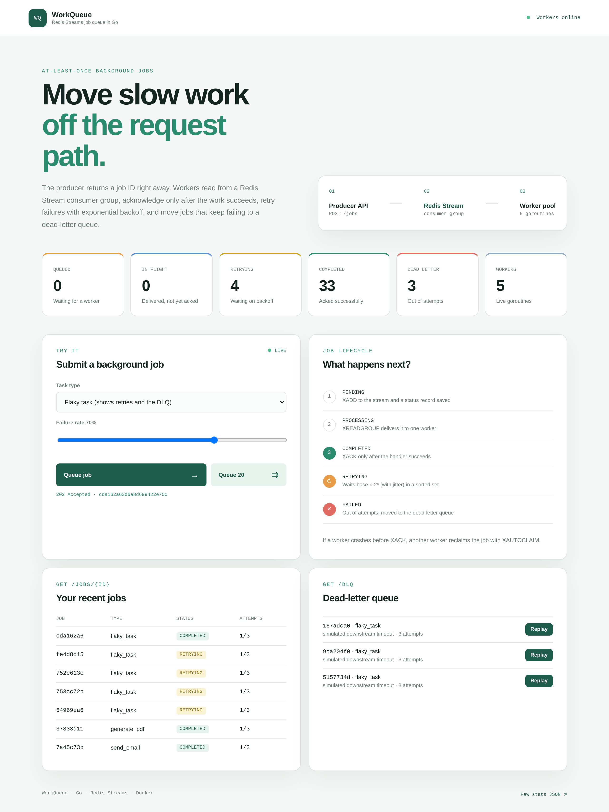
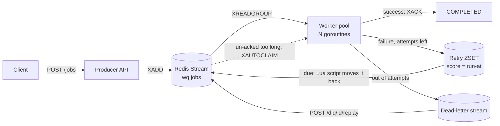

# WorkQueue


A background job queue in Go, built on Redis Streams.

My first version used a plain Redis list (`RPUSH` / `BLPOP`). It worked, but `BLPOP` removes a job the moment a worker reads it, so a worker crash in the middle of a job lost that job for good. I had that written down as a known limitation, and this version is my fix for it. Jobs now stay in Redis until a worker confirms they're done, failures are retried with backoff, and jobs that keep failing end up in a dead-letter queue you can replay.



## Try it

```bash
docker compose up --build
```

Open http://localhost:8080, pick "Flaky task" and click "Queue 20". You'll see jobs fail, wait, retry, and the unlucky ones land in the dead-letter panel, where you can replay them.

To see crash recovery, queue some jobs, run `docker compose kill -s SIGKILL worker`, then `docker compose start worker`. The jobs that were in flight get picked up again and finish. You can also run several worker processes with `docker compose up --build --scale worker=3`.

Without Docker you need Redis 6.2 or newer:

```bash
cp .env.example .env
go run ./cmd/worker     # terminal 1
go run ./cmd/producer   # terminal 2
```

## How it works



The producer validates a request, adds the job to the stream and answers `202` with a job ID. A pool of goroutines in the worker process reads from a consumer group. A worker only acknowledges (`XACK`) a job after its handler succeeds. What happens otherwise:

| Situation | Result |
|---|---|
| Handler returns an error | Retried after `base × 2^(attempt-1)` plus jitter, up to `MAX_ATTEMPTS` |
| Error wrapped in `handlers.Permanent` | No retries, straight to the dead-letter queue |
| Out of attempts | Dead-letter queue, with the last error kept |
| Handler panics | Recovered and counted as a failed attempt |
| Worker killed mid-job | Another worker reclaims it with `XAUTOCLAIM` after `2 × JOB_TIMEOUT` |
| SIGTERM | Stops reading, finishes running jobs, then exits |
| Redis down | Workers back off instead of spinning, the API returns `503` |

Delivery is at-least-once. If a worker finishes a job and dies before the ack, the job runs again, so handlers need to be safe to run twice. More detail on the Redis keys and each failure path is in [ARCHITECTURE.md](ARCHITECTURE.md).

## Benchmarks

`go run ./cmd/bench` starts a real worker pool, enqueues jobs from 8 concurrent producers and measures how long each job takes from enqueue to acknowledged. CI runs it on every push. This is the table from one run on a GitHub Actions runner, with 2,000 jobs that each simulate 10 ms of work:

| Workers | Throughput | p50 latency | p99 latency |
|--------:|-----------:|------------:|------------:|
| 1  | 92 jobs/s    | 10.9 s | 21.5 s |
| 5  | 446 jobs/s   | 2.2 s  | 4.3 s  |
| 20 | 1,740 jobs/s | 531 ms | 1.0 s  |

Throughput grows almost in step with worker count, which is what you'd expect while the work is I/O-bound. The latencies are large because all jobs are enqueued in one burst, so most of the time is spent waiting in the backlog. With a no-op handler, the queue itself topped out around 12,000 jobs/s on a 2-core machine with Redis running alongside.

## API

| Method | Path | |
|---|---|---|
| `POST` | `/jobs` | Validate and enqueue a job, returns `202` and a job ID |
| `GET` | `/jobs/{id}` | Status, attempts, last error, next retry time (kept 24 h) |
| `GET` | `/stats` | Queued, in-flight, retrying, dead-letter, completed, failed, live workers |
| `GET` | `/dlq` | Newest dead-lettered jobs |
| `POST` | `/dlq/{entry_id}/replay` | Put a dead letter back on the queue with attempts reset |
| `GET` | `/healthz` | Redis connection check |

```bash
curl -X POST localhost:8080/jobs \
  -d '{"task_type":"send_email","payload":{"to":"user@example.com","subject":"hello"}}'
# {"job_id":"9f2c...","status":"PENDING","status_url":"/jobs/9f2c...","task_type":"send_email"}
```

Task types are `send_email`, `resize_image`, `generate_pdf` and `flaky_task` (fails at a rate you choose, for watching retries). The handlers only simulate work with sleeps, since the project is about the queue and not about sending real email. Settings such as `WORKER_COUNT`, `MAX_ATTEMPTS`, `JOB_TIMEOUT` and the retry delays are environment variables, listed in [.env.example](.env.example).

## Decisions worth explaining

- Streams instead of a list: a consumer group keeps each message in a pending list until it's acked, which is what makes crash recovery possible.
- Retries wait in a sorted set scored by run-at time, because streams can't delay delivery. A small Lua script moves due jobs back, so two workers can never promote the same one.
- Each outcome (done, retry, dead-letter) acks the message and writes the next state in one `MULTI`/`EXEC`, so a job can't be acked and lost.
- Job status is a small JSON key with a 24 h expiry, and counters live in Redis, so they stay correct with several worker processes.

## Tests

```bash
go test -race ./...
```

The integration tests need Redis at `REDIS_URL` and skip if there isn't one (CI sets `REQUIRE_REDIS=1` so they fail there instead). They cover the failure paths: a job that's read but never acked gets reclaimed, retries end in the dead-letter queue, permanent errors skip retries, a panicking handler doesn't kill the worker, and shutdown waits for a running job. Each test uses its own random key prefix, so it never touches real queue data.

## Limitations

- A job can run twice, so a real system would add idempotency keys.
- A job that crashes the whole process (not just a panic) on every attempt would be reclaimed forever. Reading the delivery count from `XPENDING` would let it go to the dead-letter queue.
- One Redis instance, no auth or rate limiting on the API.

Meet Jain · [github.com/MeetJain05](https://github.com/MeetJain05)
